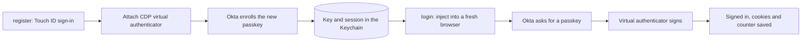

<div align="center">

<picture>
  <source media="(prefers-color-scheme: dark)" srcset="images/logo-header-dark.png">
  
</picture>

<p>
Headless passkey sign-in for Okta: HarvardKey by default, any Okta Identity Engine tenant by configuration.
Register a passkey once with Touch ID, then sign in from scripts, CI jobs and Playwright tests with no prompt.
</p>

<a href="LICENSE"></a>


</div>

> [!WARNING]
> This tool turns a passkey, normally locked in your device's secure hardware,
> into a **file you can copy**. Anyone who gets that file can sign in as you.
> Read [SECURITY.md](SECURITY.md) and check your organization's policy before
> using it.

## Table of Contents

- [Overview](#overview)
- [Quick Install](#quick-install)
- [Features](#features)
- [Usage](#usage)
- [How It Works](#how-it-works)
- [Documentation](#documentation)
- [Contributing](#contributing)
- [License](#license)

## Overview

Okta sign-in with a passkey needs a person at the keyboard: Touch ID, a
security key, a phone. That's the point for people, and a wall for automation
that needs to reach SSO-protected pages as you: scraping your own data, testing
an internal app end to end, or a scheduled report.

Crimson Headless Passkey enrolls a second passkey on your account in a
**Chrome DevTools virtual authenticator**, keeps its key in your login Keychain,
and replays it in a Playwright browser whenever a sign-in is needed. Your
everyday passkey stays where it is, and the automation one can be revoked on
its own in Okta at any time.

## Quick Install

```bash
git clone https://github.com/ventz/crimson-headless-passkey
cd crimson-headless-passkey
uv sync
uv run playwright install chromium          # the browser; skip it to use your installed Chrome
cp .env.example .env                        # optional: settings, e.g. your username
uv run crimson-headless-passkey register    # one time, interactive
uv run crimson-headless-passkey login       # signs in with no prompt
```

Requires Python 3.11+, [uv](https://docs.astral.sh/uv/) and Google Chrome.
Tested on macOS. See [Getting Started](docs/getting-started.md) for the
registration walkthrough.

## Features

- **Prompt-free sign-in**: answers Okta's passkey challenge in a CDP virtual
  authenticator, headed or `--headless`
- **Username step handled**: fills Okta's identifier-first prompt from
  `--username`, the registered name, or Okta's remembered-username cookie
- **Session reuse**: saves cookies after each sign-in and skips the passkey
  while the Okta session is valid
- **Sign counter kept current**: persists the WebAuthn counter after every
  assertion, so Okta never sees it go backwards
- **No secrets on disk**: on macOS the private key and session live in your
  login Keychain. A file mode exists, deliberately not the default, for
  fully hands-off servers
- **Careful with secrets**: `0600` atomic writes outside the repo, SSH-style
  file and directory checks, and the authenticator is removed as soon as
  sign-in ends
- **Honest results**: success needs evidence of a sign-in, never just a
  non-IdP URL. Error pages (including `chrome-error://`
  after a late redirect) fail with a reason and are never saved, and printed
  URLs hide tokens.
- **AWS SSO consent, opt-in**: `--aws-allow` clicks Allow on the AWS IAM
  Identity Center "Allow access" page after HarvardKey and checks the approval
  page loaded. Off by default because it grants AWS access to whoever started
  the request
- **Library and CLI**: `authenticate()` returns a signed-in Playwright context;
  the CLI has script-friendly exit codes
- **Offline tests**: a fake app and IdP served by Playwright routes exercise the
  full CDP flow without touching a real tenant

## Usage

```bash
crimson-headless-passkey register                 # enroll the automation passkey
crimson-headless-passkey login [URL]              # sign in; browser stays open until ENTER
crimson-headless-passkey login --headless --close https://portal.example.edu/
crimson-headless-passkey open [URL]               # signed-in browser, left open until ENTER
crimson-headless-passkey open --no-auth [URL]     # the same page with no passkey or session
crimson-headless-passkey login -v [URL]           # -v: print every redirect hop (tokens hidden)
crimson-headless-passkey login --aws-allow URL    # also approve the AWS SSO "Allow access" page
crimson-headless-passkey status                   # what is stored, without secrets
```

Prefix with `uv run` inside the repo. Color codes and whitespace pasted into a
URL are stripped. Exit codes: `0` signed in, `1` not
signed in, `2` configuration error. Every flag and environment variable is in
[Configuration](docs/configuration.md).

Same page, with and without the passkey:

```bash
crimson-headless-passkey open --no-auth https://login.harvard.edu/account-settings/   # sign-in form
crimson-headless-passkey open https://login.harvard.edu/account-settings/            # your account
```

Or headless: sign in with no human, then read your name and email off Okta's
account page.

```bash
uv run python examples/whoami.py --fresh
# Name:   Your Name
# Email:  you@g.harvard.edu
# Signed in with the passkey in 5.3 s. Thumbs used: 0
```

From Python:

```python
result = await authenticate(browser, Settings.from_env(), "https://portal.example.edu/")
assert result.ok
page = result.page  # signed in
```

## How It Works



The ordering rules (when to attach the authenticator, why `enableUI` is off,
why credentials are captured from events) are in
[How It Works](docs/how-it-works.md).

## Documentation

| Guide | What's in it |
|-------|--------------|
| [Getting Started](docs/getting-started.md) | Registration walkthrough, first login, scripting and Python use |
| [Configuration](docs/configuration.md) | Every flag, environment variable, file and exit code; other Okta tenants |
| [How It Works](docs/how-it-works.md) | Sequence diagrams, CDP timing rules, sign counter, success detection |
| [Troubleshooting](docs/troubleshooting.md) | Known failure modes and fixes |
| [Security](SECURITY.md) | Threat model, protecting the credential, revoking it, reporting issues |
| [Changelog](CHANGELOG.md) | Release history |

## Contributing

Issues and pull requests are welcome. See [CONTRIBUTING.md](CONTRIBUTING.md)
for the development setup and test commands. Please report security problems
privately as described in [SECURITY.md](SECURITY.md).

This project is not affiliated with or endorsed by Harvard University or Okta.

## License

[MIT](LICENSE) © Ventz Petkov
