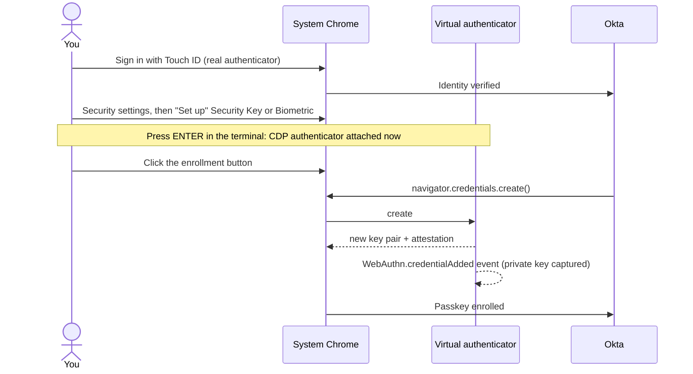
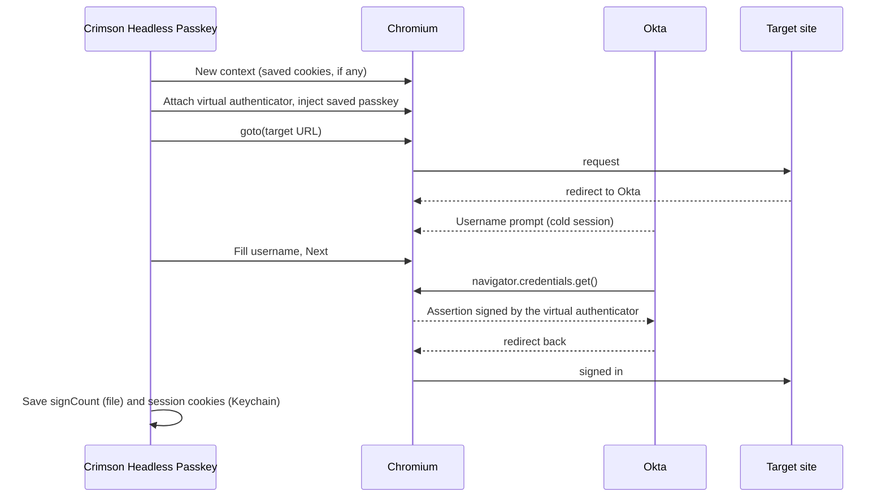

# How It Works

Crimson Headless Passkey signs in to Okta with a passkey whose private key
lives in your Keychain (or a file) instead of in your laptop's secure
hardware. Chrome's DevTools Protocol (CDP)
can attach a **virtual authenticator** to a page: a software FIDO2 device that
answers `navigator.credentials.create()` and `.get()` the way Touch ID or a
security key would, without any human present. This tool registers a passkey
on such a device, saves its private key, and injects it again on every login.

## Table of Contents

- [Registration](#registration)
- [Login](#login)
- [Timing Rules](#timing-rules)
- [Sign Counter](#sign-counter)
- [Detecting a Finished Sign-In](#detecting-a-finished-sign-in)
- [After Sign-In](#after-sign-in)
- [Code Map](#code-map)

## Registration

Okta only lets you add a new authenticator after you prove who you are, so
registration has two phases in one browser window:

Phase one uses **system Chrome** (`channel="chrome"`) because Playwright's
bundled Chromium has no Touch ID or iCloud Keychain support. Playwright
launches it with a throwaway profile, so it normally runs fine next to your
everyday Chrome (see `--quit-chrome` in [Troubleshooting](troubleshooting.md)
if it doesn't).

The credential is captured from the `WebAuthn.credentialAdded` event the moment
it is created. Okta navigates right after enrollment, and asking the
authenticator for its credentials afterwards (`WebAuthn.getCredentials`) can
fail, so the event is the source of truth and `getCredentials` is only a
fallback.

## Login

With a still-valid Okta session in the saved cookies, Okta skips straight to
the redirect and no passkey ceremony happens at all.

## Timing Rules

These cost real debugging time and are the reason the code is shaped the way it
is:

| Rule | Why |
|------|-----|
| Registration attaches the authenticator **only right before** enrollment | `WebAuthn.enable` sends *every* WebAuthn call on the page to virtual authenticators. Attached earlier, it swallows the Touch ID sign-in and Okta reports "operation timed out or not allowed". |
| Login attaches it **before the first navigation** | The credential must already be present when Okta calls `credentials.get()`. |
| `WebAuthn.enable` always uses `enableUI: false` | With `true`, Chrome shows its own "use your security key" sheet (on macOS often "Bluetooth is disabled"), and the virtual authenticator never sees the request. |
| Credentials are injected as discoverable (`isResidentCredential: true`) | Okta looks the passkey up without being told which credential to use. Older credential files saved `false`, and login overrides it. |
| The authenticator is `ctap2` / `internal` with `isUserVerified: true` | It looks like a platform authenticator (Touch ID) that has already verified the user, which is what Okta's "Security Key or Biometric" asks for. |

## Sign Counter

Every assertion increments the credential's signature counter, and Okta stores
the last value it saw. A counter that goes backwards is the standard WebAuthn
signal for a cloned authenticator. Each login therefore records the counter
from the `WebAuthn.credentialAsserted` event (plus `getCredentials` while the
session is alive) and writes it back to the credential file, **only ever
upward** and even when sign-in did not finish. Okta asserts twice per sign-in
on login.harvard.edu, so expect the counter to climb by 2.

## Detecting a Finished Sign-In

`login` polls the page URL. A URL counts as a destination when it is https
(or http on localhost) and has **left every IdP host**, or has reached one of
Okta's own **signed-in pages** (`/account-settings/`, `/enduser/`,
`/app/UserHome`, matched on whole path segments). The second case matters when
the target is the IdP itself: `login.harvard.edu` ends on `/account-settings/`
after a successful sign-in.

A destination URL alone is not proof, because an app's first page looks the
same before it redirects to the IdP from JavaScript. Success also needs one of:

- the IdP was visited during this run (main-frame navigation),
- a passkey assertion happened, or
- the page stayed on the same URL for 3 seconds. This covers an app that still
  had its own valid session and never involved the IdP.

Chrome's error page (`chrome-error://`) ends the wait at once as a failure, and
the reason is reported (`LoginResult.reason`, and on the command line). The
final URL is checked again after redirects settle: a script redirect that fails
*after* sign-in also ends on `chrome-error://chromewebdata/`, and that, or any
other non-http(s) page, turns the result into a failure. `login` checks once
more before saving the session, so an error page is never saved as signed in.

Hosts are compared by parsed hostname, never by substring, so a URL that only
mentions the IdP in its query string (`?redirect_uri=https://login...`) does
not count as being on the IdP.

While polling, if Okta's identifier-first username field
(`input[name="identifier"]`) shows on an IdP host, the tool fills it once and
submits. The username comes from, in order: `--username`, the
`CRIMSON_HEADLESS_PASSKEY_USERNAME` env var, the user name saved at
registration, then Okta's own remembered-username cookie (`ln`) in the saved
session. With none of these available it stops right away and says so.

## After Sign-In

Once sign-in has finished, or failed, the tool saves the signature counter and
then **removes the virtual authenticator** (`WebAuthn.removeVirtualAuthenticator`
and `WebAuthn.disable`). While attached, any page on the IdP's origin in that
tab would get silent, user-verified assertions, including Okta's step-up
prompts for sensitive settings. The page you get back, or keep open with
`--keep-open`, behaves like a browser with no passkey at all.

A sign-in holds an exclusive lock (`.lock` in the data directory) from loading
the credential to saving the counter, so overlapping runs (cron plus a manual
run, parallel CI jobs) take turns instead of presenting the same counter value.

## Code Map

| Module | Responsibility |
|--------|----------------|
| `config.py` | Defaults, env vars, `Settings`, host and URL matching |
| `envfile.py` | `.env` parsing, ownership check, merging under the real environment |
| `secretstore.py` | Where the secrets live: the OS keychain (through `keyring`) or `0600` files |
| `storage.py` | Owner-only atomic JSON writes, SSH-style file and directory checks, credential validation, sign-count merging, run lock |
| `authenticator.py` | `VirtualAuthenticator`: CDP attach, inject, events |
| `flows.py` | `authenticate()` (library entry point), `login`, `register`, `open_url` |
| `cli.py` | Argument parsing, exit codes |

Tests in `tests/test_browser.py` run the same code against a fake app and a
fake IdP served by Playwright routes, entirely offline, so the CDP behavior
above is checked on every run without touching a real Okta tenant.
